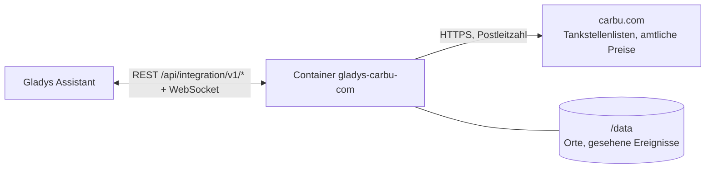
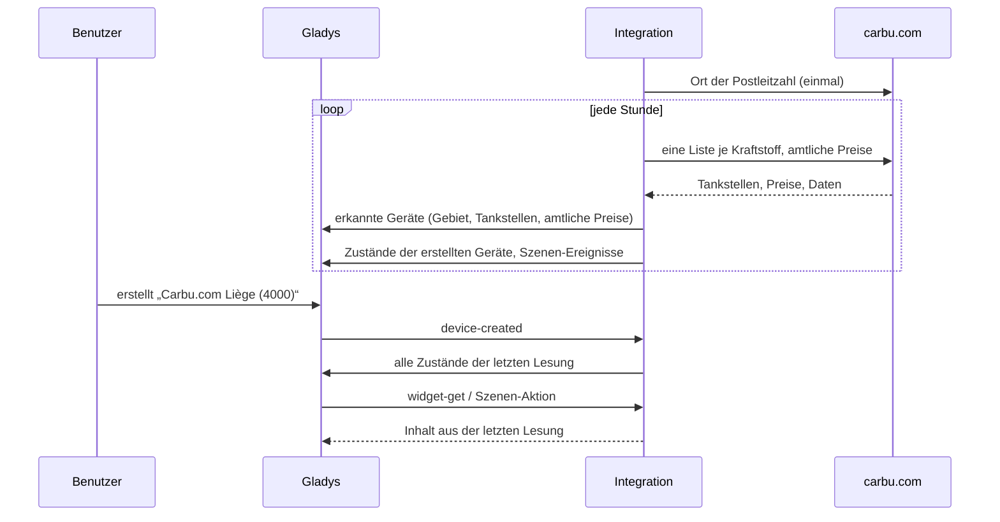
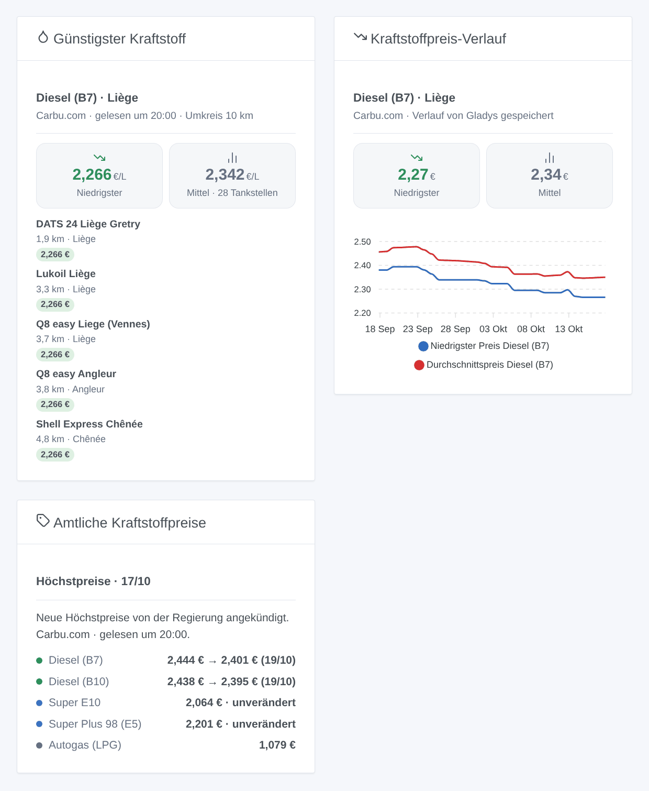

# Gladys Carbu.com

[English](README.md) · [Français](README.fr.md) · **Deutsch** · [Español](README.es.md)

[](LICENSE)
[](https://github.com/William-De71/gladys-carbu-com/releases)
[](https://github.com/William-De71/gladys-carbu-com/actions/workflows/release.yml)
[](https://gladysassistant.com)


Externe [Gladys Assistant](https://gladysassistant.com)-Integration für **Carbu.com**, den Kraftstoffpreisvergleich für Belgien, Frankreich und Luxemburg: niedrigster und durchschnittlicher Preis in Ihrer Nähe, die günstigsten Tankstellen und die belgischen Höchstpreise samt angekündigter Entwicklung. Kein Konto nötig: Die Integration liest die öffentlichen Seiten von Carbu.com für Ihre Postleitzahl.

Benutzerdokumentation: [English](docs/en.md) · [Français](docs/fr.md) · [Deutsch](docs/de.md) · [Español](docs/es.md).

> Community-Integration, weder mit Carbu.com noch mit Fuel Media Service verbunden oder von ihnen unterstützt.

## Funktionen

- **Ein Gebiet** um einen Ort (Postleitzahl) in Belgien, Frankreich oder Luxemburg, im Umkreis von 2 bis 30 km, für bis zu **vier Kraftstoffe** aus elf (Super E10 und E5, Super Plus 98 E5 und E10, Diesel B7, B10, XTL / HVO, Premium-Diesel, Autogas, Erdgas, E85, je nach Land).
- **Ein Gebiets-Gerät**: niedrigster Preis, Durchschnittspreis und günstigste Tankstelle je Kraftstoff, mit dem Verlauf, den Gladys speichert.
- **Tankstellen-Geräte**, angeboten unter den günstigsten je Kraftstoff: der Preis jedes verfolgten Kraftstoffs, den sie verkaufen.
- **Ein Gerät für amtliche Preise**: die heutigen belgischen Höchstpreise, der nächste (von der Regierung angekündigt, sonst von Carbu.com erwartet) und die Aussicht; die amtlichen Preise Luxemburgs.
- **5 Szenen-Auslöser**, **2 Szenen-Aktionen** und **3 Dashboard-Widgets** (siehe unten).
- Veraltete Preise (manche französische Tankstellen zeigen jahrealte Preise) werden ignoriert: standardmäßig nach 7 Tagen.
- Standardmäßig stündliches Lesen (30 Min. bis 4 Std.); Konfigurationsschaltflächen: Verbindung testen, Diagnose.
- Vier Sprachen überall: Englisch, Französisch, Deutsch, Spanisch.

## Funktionsweise




Carbu.com hat keine API: Die Integration liest dieselben Seiten wie ein Besucher, auf Französisch, und stellt sich vor (`gladys-carbu-com/<version>`). Sie ermittelt zuerst den Ort Ihrer Postleitzahl (einmal, in `/data` gespeichert) und liest dann bei jedem Durchgang **eine Tankstellenliste je verfolgtem Kraftstoff** (bis zu 100 Tankstellen um die Ortsmitte, mit dem Datum jedes Preises) und, in Belgien und Luxemburg, **die Tabelle der amtlichen Preise**. Sie behält die Tankstellen im Umkreis mit aktuellem Preis, sortiert sie nach Preis, veröffentlicht die Zustände und vergleicht jede Lesung mit der vorigen, um die Szenen-Auslöser zu starten.



### Transport

Nur Cloud (`"transports": ["cloud"]`): Der Katalog zeigt das Cloud-Abzeichen. Nur Ihre Postleitzahl (und der gewählte Ort) und die Codes der verfolgten Kraftstoffe gehen an `carbu.com`. Es gibt keinen lokalen Weg, daher keine Schaltfläche „Lokale Verbindung bevorzugen“.

## Geräte und Funktionen

| Gerät                               | Funktion                              | Kategorie / Typ        | Werte                                    |
| ----------------------------------- | ------------------------------------- | ---------------------- | ---------------------------------------- |
| Carbu.com \<Ort\> (\<PLZ\>)         | Niedrigster Preis, Durchschnittspreis | `currency` / `decimal` | 0 … 10 €/L                               |
| Carbu.com \<Ort\> (\<PLZ\>)         | Günstigste Tankstelle \<Kraftstoff\>  | `text` / `text`        | „Shell Express Liège · 2,274 € · 1,3 km“ |
| \<Tankstelle\>                      | Preis \<Kraftstoff\>                  | `currency` / `decimal` | 0 … 10 €/L                               |
| Carbu.com belgische Höchstpreise    | Höchstpreis, nächster Höchstpreis     | `currency` / `decimal` | 0 … 10 €/L                               |
| Carbu.com belgische Höchstpreise    | Aussicht \<Kraftstoff\>               | `text` / `text`        | „Senkung ab 22/04 angekündigt: 2,061 €“  |
| Carbu.com luxemburgische Amtspreise | Amtlicher Preis \<Kraftstoff\>        | `currency` / `decimal` | 0 … 10 €/L                               |

Entfernungen werden wie auf Carbu.com ab der Ortsmitte gemessen. Eine hinzugefügte Tankstelle behält ihren Preis auch außerhalb des Umkreises; ein Kraftstoff ohne aktuellen Preis im Umkreis lässt die Preise unverändert und meldet es unter „Günstigste Tankstelle“.

## Szenen-Auslöser, -Aktionen und Widgets



**Szenen-Auslöser** (einmal pro Übergang; die erste Lesung ist die Referenz und löst nichts aus):

- **Neue günstigste Tankstelle**: Eine andere Tankstelle wird im Gebiet die günstigste für einen Kraftstoff (bei Gleichstand bleibt die bisherige). Filter: Kraftstoff.
- **Preisänderung an einer Tankstelle**: Der Preis eines Kraftstoffs ändert sich an einer als Gerät hinzugefügten Tankstelle. Filter: Tankstelle, Kraftstoff, Richtung.
- **Amtlicher Preis geändert**: Der heutige amtliche Preis weicht von gestern ab (Belgien, Luxemburg). Filter: Kraftstoff, Richtung.
- **Höchstpreis angekündigt**: Die belgische Regierung kündigt einen neuen Höchstpreis für den nächsten Tag an. Filter: Kraftstoff, Richtung.
- **Höchstpreisänderung erwartet**: Carbu.com erwartet eine Erhöhung oder Senkung vor der amtlichen Ankündigung. Filter: Kraftstoff, Richtung.

**Szenen-Aktionen**: **günstigste Tankstelle** eines Kraftstoffs (in einer Entfernung: Name, Marke, Adresse, Preis, Entfernung, Kartenlink) und **amtliche Preise** eines Kraftstoffs (heute, nächster Preis, Datum, Tendenz, angekündigt oder erwartet).

**Widgets**: **Günstigster Kraftstoff** (Kacheln niedrigster und durchschnittlicher Preis, dann die Liste mit Entfernung und Link zu Carbu.com oder zur Karte), **Kraftstoffpreis-Verlauf** (Kurven des niedrigsten und durchschnittlichen Preises, von Gladys aus dem Gebiets-Gerät gezeichnet) und **Amtliche Kraftstoffpreise**.

Beispiele:

- Wenn **eine Erhöhung des Diesel-Höchstpreises angekündigt wird** → mir „Heute tanken: morgen {{triggerEvent.data.new_price}} €“ senden.
- Wenn **die günstigste Autogas-Tankstelle wechselt** → `{{triggerEvent.data.station_name}}` zu `{{triggerEvent.data.price}}` € mit `map_url` melden.
- Jeden Freitag um 17 Uhr → **die günstigste Tankstelle** im Umkreis von 5 km lesen und über den Lautsprecher im Flur ansagen.

## Voraussetzungen

- Gladys Assistant **5.1.1** oder neuer (Widgets und Szenen-Auslöser externer Integrationen). Ältere Instanzen können die Integration nicht installieren.
- Internetzugang. Kein Konto, kein Schlüssel.

## Installation

- **Aus dem Gladys-Store** (Integrationen → Externe Integrationen) mit einem Klick, sobald indexiert.
- **Über die Repository-URL**: `https://github.com/William-De71/gladys-carbu-com`.
- **Entwicklermodus**: Image lokal bauen (`docker build -t gladys-carbu-com .`) und in Gladys installieren.

## Konfiguration

| Feld                                    | Beschreibung                                                                                  |
| --------------------------------------- | --------------------------------------------------------------------------------------------- |
| Land                                    | Belgien, Frankreich oder Luxemburg.                                                           |
| Postleitzahl                            | Die Mitte des Gebiets („4000“, „71100“, „1009“).                                              |
| Ort (optional)                          | Wenn die Postleitzahl mehrere Orte umfasst (4000: Liège, Glain, Rocourt). Leer: der Hauptort. |
| Kraftstoffe                             | Höchstens vier; hinter dem Namen stehen die Länder, in denen Carbu.com ihn führt.             |
| Umkreis                                 | 2, 5, 10 (Standard), 15, 20 oder 30 km.                                                       |
| Preise ignorieren, die älter sind als   | 1, 2, 3, 7 (Standard), 14 oder 30 Tage.                                                       |
| In der Erkennung angebotene Tankstellen | Keine, 3, 5 (Standard), 10 oder 20 pro Kraftstoff.                                            |
| Leseintervall                           | 30 Min., 1 Std. (Standard), 2 Std. oder 4 Std.                                                |
| Sprache der Gerätenamen                 | Automatisch (die Sprache des Dashboards) oder eine feste Sprache.                             |

Schaltflächen: **Verbindung testen** (Orte der Postleitzahl, Anzahl der Tankstellen und niedrigster Preis je Kraftstoff, amtliche Preise) und **Diagnose** (schreibt Ort, Lesungen und Fehler in den Tab Protokolle).

## Verwendung

1. Land wählen, Postleitzahl und Kraftstoffe eingeben und speichern.
2. Im Tab **Erkennung** das Gerät „Carbu.com \<Ort\>“, das Gerät der amtlichen Preise und die gewünschten Tankstellen erstellen.
3. Die Widgets einem Dashboard hinzufügen und Szenen mit den obigen Auslösern erstellen.

## Entwicklung

```bash
npm install
npm test                       # node --test, berührt nie das Netzwerk
npm run lint && npm run format:check
npx github:GladysAssistant/integration-store . --skip-image-check
scripts/build-cover.sh         # cover.jpg aus docs/assets/cover.svg
docs/illustrations/render.sh   # docs/assets/widgets.<lang>.png
node .github/scripts/release.mjs next
```

Lokal liest das SDK `GLADYS_HOST_API_URL`, `GLADYS_INTEGRATION_TOKEN` und `GLADYS_INTEGRATION_SELECTOR`; `CARBU_BASE_URL` leitet die Integration auf eine andere Wurzel um (ein Stub); `DEBUG=gladys-integration-sdk` zeigt die SDK-Protokolle und prüft jeden Widget-Inhalt. Die Tests verwenden echte, gekürzte Seiten von Carbu.com (`test/fixtures/`). Die Projektregeln stehen in [CLAUDE.md](CLAUDE.md).

## Release-Prozess


Jeder Merge auf `main` startet die CI und berechnet dann die Version aus den [Conventional Commits](https://www.conventionalcommits.org/) seit dem letzten Tag: `feat` → Minor, `fix` / `perf` → Patch, `!` oder `BREAKING CHANGE` → Major (ein Minor vor 1.0.0); `docs`, `chore`, `ci`, `test`, `style`, `refactor`, `build` allein veröffentlichen nichts. Der Changelog-Abschnitt wird erzeugt, der Tag gepusht, das Multi-Arch-Image gebaut, dann erhält `main` den Release-Commit, die GitHub-Release wird erstellt und ein letzter Job prüft das öffentliche Image, den Store-Validator und das Topic.

- Der Titel des Pull Requests wird zum Squash-Commit und dann zur Changelog-Zeile: auf Englisch und für den Benutzer schreiben (`pr-title.yml` prüft ihn). `CHANGELOG.md` nie von Hand bearbeiten.
- 1.0.0 ist eine Entscheidung: Actions → Release → Run workflow mit `release-as: 1.0.0`. `dry-run` zeigt Version und Notizen, ohne etwas zu veröffentlichen.
- **Geschützter Branch**: Die Release pusht ihren Commit mit `GITHUB_TOKEN` auf `main`. Mit einem Ruleset auf `main` GitHub Actions zur Bypass-Liste hinzufügen (oder über eine GitHub App pushen), sonst scheitert der Veröffentlichungs-Job mit Anweisungen.
- Nach der ersten Release das `ghcr.io`-Paket öffentlich machen (Package settings → Change visibility), sonst kann Gladys es nicht herunterladen.

## Fehlerbehebung

Siehe [docs/de.md](docs/de.md#fehlerbehebung). Probleme mit den Versionen von Gladys und der Integration, Land, Postleitzahl und Kraftstoffen sowie den Zeilen der Schaltfläche **Diagnose** melden.

## Mitwirken

Issues und Pull Requests sind willkommen. Vor einem Pull Request `npm run format:check && npm run lint && npm test` ausführen und alle externen IDs und gespeicherten Schlüssel unverändert lassen (siehe [CLAUDE.md](CLAUDE.md)). Ändert Carbu.com sein Layout, die neue gekürzte Seite mit der Korrektur in `test/fixtures/` ablegen.

## Sicherheit

Siehe [SECURITY.md](SECURITY.md): Schwachstellen vertraulich melden. Die Integration hat weder Konto noch Geheimnis; sie läuft schreibgeschützt, ohne Root-Rechte, in ihrem Container und kontaktiert nur `carbu.com`.

## Kommende Screenshots

Die Bilder oben sind Illustrationen, keine Screenshots. Echte Screenshots kommen nach `docs/assets/screenshots/` (PNG, 1280 × 800): `configuration.png`, `discovery.png`, `device.png`, `scene.png`.

## Lizenz

[Apache-Lizenz 2.0](LICENSE) — siehe auch [NOTICE](NOTICE). Die Preise stammen von [Carbu.com](https://carbu.com) (Fuel Media Service): Die Widgets zeigen die Quelle und die Uhrzeit jeder Lesung. Das Lesen der Seiten wurde von den Home-Assistant-Integrationen carbu_com (myTselection) und carbu-hass (Michel Heusschen) gelernt. Danke an die Dokumentation und das SDK von Gladys.
