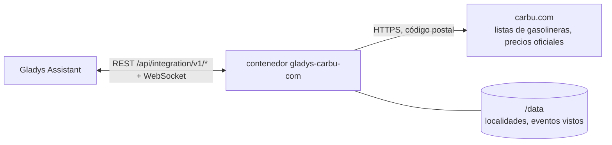
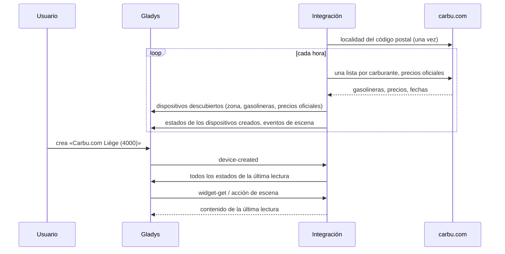
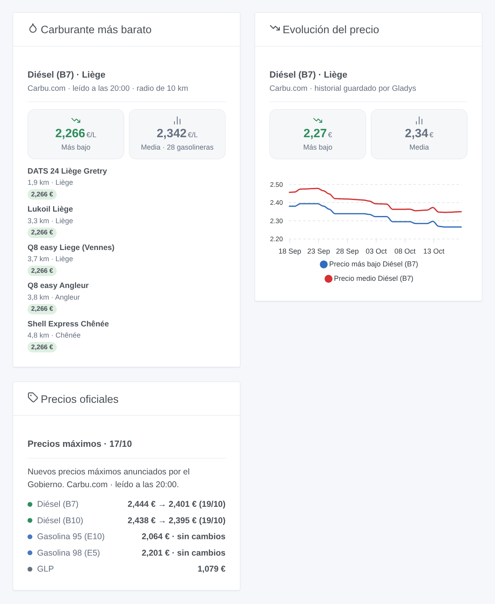

# Gladys Carbu.com

[English](README.md) · [Français](README.fr.md) · [Deutsch](README.de.md) · **Español**

[](LICENSE)
[](https://github.com/William-De71/gladys-carbu-com/releases)
[](https://github.com/William-De71/gladys-carbu-com/actions/workflows/release.yml)
[](https://gladysassistant.com)


Integración externa de [Gladys Assistant](https://gladysassistant.com) para **Carbu.com**, el comparador de precios del carburante de Bélgica, Francia y Luxemburgo: el precio más bajo y el precio medio cerca de su casa, las gasolineras más baratas y los precios máximos belgas con su evolución anunciada. Sin cuenta: la integración lee las páginas públicas de Carbu.com para su código postal.

Documentación de usuario: [English](docs/en.md) · [Français](docs/fr.md) · [Deutsch](docs/de.md) · [Español](docs/es.md).

> Integración comunitaria, sin afiliación ni respaldo de Carbu.com ni de Fuel Media Service.

## Funcionalidades

- **Una zona** alrededor de una localidad (código postal) de Bélgica, Francia o Luxemburgo, en un radio de 2 a 30 km, para hasta **cuatro carburantes** entre once (gasolina 95 E10 y E5, gasolina 98 E5 y E10, diésel B7, B10, XTL / HVO, diésel prémium, GLP, GNC, E85, según el país).
- **Un dispositivo de zona**: precio más bajo, precio medio y gasolinera más barata de cada carburante, con el historial que guarda Gladys.
- **Dispositivos de gasolinera**, propuestos entre las más baratas de cada carburante: el precio de cada carburante seguido que venden.
- **Un dispositivo de precios oficiales**: los precios máximos belgas de hoy, el siguiente (anunciado por el Gobierno, si no previsto por Carbu.com) y la tendencia; los precios oficiales de Luxemburgo.
- **5 disparadores de escena**, **2 acciones de escena** y **3 widgets de panel** (abajo).
- Los precios antiguos (algunas gasolineras francesas muestran precios de hace años) se descartan: 7 días por defecto.
- Lectura cada hora por defecto (30 min a 4 h); botones de configuración: probar la conexión, diagnóstico.
- Cuatro idiomas en todo: inglés, francés, alemán, español.

## Funcionamiento




Carbu.com no tiene API: la integración lee las mismas páginas que un visitante, en francés, presentándose (`gladys-carbu-com/<versión>`). Primero busca la localidad de su código postal (una vez, guardada en `/data`) y luego lee en cada pasada **una lista de gasolineras por carburante seguido** (hasta 100 gasolineras alrededor del centro de la localidad, con la fecha de cada precio) y, en Bélgica y Luxemburgo, **la tabla de precios oficiales**. Conserva las gasolineras del radio con un precio reciente, las ordena por precio, publica los estados y compara cada lectura con la anterior para lanzar los disparadores de escena.



### Transporte

Solo nube (`"transports": ["cloud"]`): el catálogo muestra la insignia de nube. Solo su código postal (y la localidad elegida) y los códigos de los carburantes seguidos van a `carbu.com`. No hay vía local, por lo que no hay botón «Preferir la conexión local».

## Dispositivos y funcionalidades

| Dispositivo                               | Funcionalidad                        | Categoría / tipo       | Valores                                  |
| ----------------------------------------- | ------------------------------------ | ---------------------- | ---------------------------------------- |
| Carbu.com \<localidad\> (\<código\>)      | Precio más bajo, precio medio        | `currency` / `decimal` | 0 … 10 €/L                               |
| Carbu.com \<localidad\> (\<código\>)      | Gasolinera más barata \<carburante\> | `text` / `text`        | «Shell Express Liège · 2,274 € · 1,3 km» |
| \<gasolinera\>                            | Precio \<carburante\>                | `currency` / `decimal` | 0 … 10 €/L                               |
| Carbu.com precios máximos belgas          | Precio máximo, próximo precio máximo | `currency` / `decimal` | 0 … 10 €/L                               |
| Carbu.com precios máximos belgas          | Tendencia \<carburante\>             | `text` / `text`        | «Bajada anunciada el 22/04: 2,061 €»     |
| Carbu.com precios oficiales de Luxemburgo | Precio oficial \<carburante\>        | `currency` / `decimal` | 0 … 10 €/L                               |

Las distancias se cuentan desde el centro de la localidad, como en Carbu.com. Una gasolinera añadida conserva su precio aunque esté fuera del radio; un carburante sin ningún precio reciente en el radio deja los precios sin cambios y lo indica en «Gasolinera más barata».

## Disparadores, acciones de escena y widgets



**Disparadores de escena** (una vez por transición; la primera lectura sirve de referencia y no dispara nada):

- **Nueva gasolinera más barata**: otra gasolinera pasa a ser la más barata de la zona para un carburante (un empate conserva la anterior). Filtro: carburante.
- **Cambio de precio en una gasolinera**: el precio de un carburante cambia en una gasolinera añadida como dispositivo. Filtros: gasolinera, carburante, sentido.
- **Precio oficial modificado**: el precio oficial de hoy difiere del de ayer (Bélgica, Luxemburgo). Filtros: carburante, sentido.
- **Precio máximo anunciado**: el Gobierno belga anuncia un nuevo precio máximo para el día siguiente. Filtros: carburante, sentido.
- **Cambio de precio máximo previsto**: Carbu.com prevé una subida o una bajada antes del anuncio oficial. Filtros: carburante, sentido.

**Acciones de escena**: **gasolinera más barata** de un carburante (en una distancia: nombre, marca, dirección, precio, distancia, enlace al mapa) y **precios oficiales** de un carburante (hoy, precio siguiente, fecha, tendencia, anunciado o previsto).

**Widgets**: **Carburante más barato** (mosaicos de precio más bajo y medio, luego la lista con la distancia y un enlace a Carbu.com o al mapa), **Evolución del precio** (curvas del precio más bajo y medio, dibujadas por Gladys a partir del dispositivo de zona) y **Precios oficiales**.

Ejemplos:

- Cuando **se anuncia una subida del precio máximo del diésel** → enviarme «Llene el depósito hoy: mañana {{triggerEvent.data.new_price}} €».
- Cuando **cambia la gasolinera de GLP más barata** → notificar `{{triggerEvent.data.station_name}}` a `{{triggerEvent.data.price}}` €, con `map_url`.
- Cada viernes a las 17:00 → **leer la gasolinera más barata** a 5 km y anunciarla por el altavoz de la entrada.

## Requisitos

- Gladys Assistant **5.3.0** o posterior (palabras clave y países del catálogo de Gladys 5.3, widgets y disparadores de escena de las integraciones externas). Las instancias más antiguas no pueden instalar la integración.
- Acceso a internet. Sin cuenta, sin clave.

## Instalación

- **Desde la tienda** de Gladys (Integraciones → Integraciones externas), con un clic, una vez indexada.
- **Desde la URL del repositorio**: `https://github.com/William-De71/gladys-carbu-com`.
- **Modo desarrollador**: construya la imagen en local (`docker build -t gladys-carbu-com .`) e instálela desde Gladys.

## Configuración

| Campo                                       | Descripción                                                                               |
| ------------------------------------------- | ----------------------------------------------------------------------------------------- |
| País                                        | Bélgica, Francia o Luxemburgo.                                                            |
| Código postal                               | El centro de la zona («4000», «71100», «1009»).                                           |
| Localidad (opcional)                        | Cuando el código postal abarca varias (4000: Lieja, Glain, Rocourt). Vacío: la principal. |
| Carburantes                                 | Cuatro como máximo; tras el nombre figuran los países donde Carbu.com lo ofrece.          |
| Radio                                       | 2, 5, 10 (por defecto), 15, 20 o 30 km.                                                   |
| Ignorar precios con más de                  | 1, 2, 3, 7 (por defecto), 14 o 30 días.                                                   |
| Gasolineras propuestas en el descubrimiento | Ninguna, 3, 5 (por defecto), 10 o 20 por carburante.                                      |
| Frecuencia de lectura                       | 30 min, 1 h (por defecto), 2 h o 4 h.                                                     |
| Idioma de los nombres de dispositivos       | Automático (el idioma del panel) o un idioma fijo.                                        |

Botones: **Probar la conexión** (localidades del código postal, número de gasolineras y precio más bajo de cada carburante, precios oficiales) y **Diagnóstico** (escribe la localidad, las lecturas y los errores en la pestaña Registros).

## Uso

1. Elija el país, introduzca el código postal y los carburantes, y guarde.
2. En la pestaña **Descubrir**, cree el dispositivo «Carbu.com \<localidad\>», el de los precios oficiales y las gasolineras que le interesen.
3. Añada los widgets a un panel y cree escenas con los disparadores anteriores.

## Desarrollo

```bash
npm install
npm test                       # node --test, nunca toca la red
npm run lint && npm run format:check
npx github:GladysAssistant/integration-store . --skip-image-check
scripts/build-cover.sh         # cover.jpg desde docs/assets/cover.svg
docs/illustrations/render.sh   # docs/assets/widgets.<lang>.png
node .github/scripts/release.mjs next
```

En local, el SDK lee `GLADYS_HOST_API_URL`, `GLADYS_INTEGRATION_TOKEN` y `GLADYS_INTEGRATION_SELECTOR`; `CARBU_BASE_URL` dirige la integración a otra raíz (un simulador); `DEBUG=gladys-integration-sdk` muestra los registros del SDK y comprueba cada contenido de widget. Las pruebas usan páginas reales de Carbu.com, reducidas (`test/fixtures/`). Las reglas del proyecto están en [CLAUDE.md](CLAUDE.md).

## Proceso de publicación


Cada fusión en `main` lanza la CI y luego calcula la versión a partir de los [Conventional Commits](https://www.conventionalcommits.org/) desde la última etiqueta: `feat` → menor, `fix` / `perf` → parche, `!` o `BREAKING CHANGE` → mayor (una menor antes de 1.0.0); `docs`, `chore`, `ci`, `test`, `style`, `refactor`, `build` solos no publican nada. Se genera la sección del changelog, se empuja la etiqueta, se construye la imagen multiarquitectura, luego `main` recibe el commit de publicación, se crea la GitHub Release y un último trabajo comprueba la imagen pública, el validador de la tienda y el topic.

- El título de la pull request se convierte en el commit squash y luego en la línea del changelog: escríbalo en inglés, para el usuario (`pr-title.yml` lo comprueba). Nunca edite `CHANGELOG.md` a mano.
- La 1.0.0 es una decisión: Actions → Release → Run workflow con `release-as: 1.0.0`. `dry-run` muestra la versión y las notas sin publicar nada.
- **Rama protegida**: la publicación empuja su commit a `main` con `GITHUB_TOKEN`. Con un ruleset en `main`, añada GitHub Actions a su lista de exención (o empuje mediante una GitHub App); si no, el trabajo de publicación falla con instrucciones.
- Tras la primera publicación, haga público el paquete `ghcr.io` (Package settings → Change visibility); si no, Gladys no puede descargarlo.

## Solución de problemas

Vea [docs/es.md](docs/es.md#solución-de-problemas). Informe de los problemas con las versiones de Gladys y de la integración, el país, el código postal y los carburantes, y las líneas del botón **Diagnóstico**.

## Contribuir

Issues y pull requests bienvenidas. Ejecute `npm run format:check && npm run lint && npm test` antes de abrir una pull request y mantenga sin cambios todos los identificadores externos y claves guardadas (vea [CLAUDE.md](CLAUDE.md)). Si Carbu.com cambia su diseño, añada la nueva página reducida en `test/fixtures/` con la corrección.

## Seguridad

Vea [SECURITY.md](SECURITY.md): informe de las vulnerabilidades en privado. La integración no tiene cuenta ni secreto; se ejecuta en solo lectura, sin derechos de root, en su contenedor, y solo contacta con `carbu.com`.

## Capturas por venir

Las imágenes anteriores son ilustraciones, no capturas de pantalla. Las capturas reales irán a `docs/assets/screenshots/` (PNG, 1280 × 800): `configuration.png`, `discovery.png`, `device.png`, `scene.png`.

## Licencia

[Licencia Apache 2.0](LICENSE) — vea también [NOTICE](NOTICE). Los precios proceden de [Carbu.com](https://carbu.com) (Fuel Media Service): los widgets muestran la fuente y la hora de cada lectura. La lectura de las páginas se aprendió de las integraciones de Home Assistant carbu_com (myTselection) y carbu-hass (Michel Heusschen). Gracias a la documentación y al SDK de Gladys.
