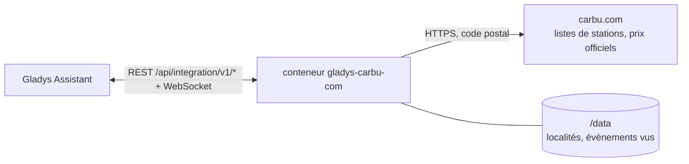
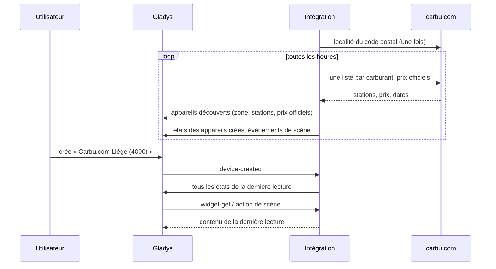
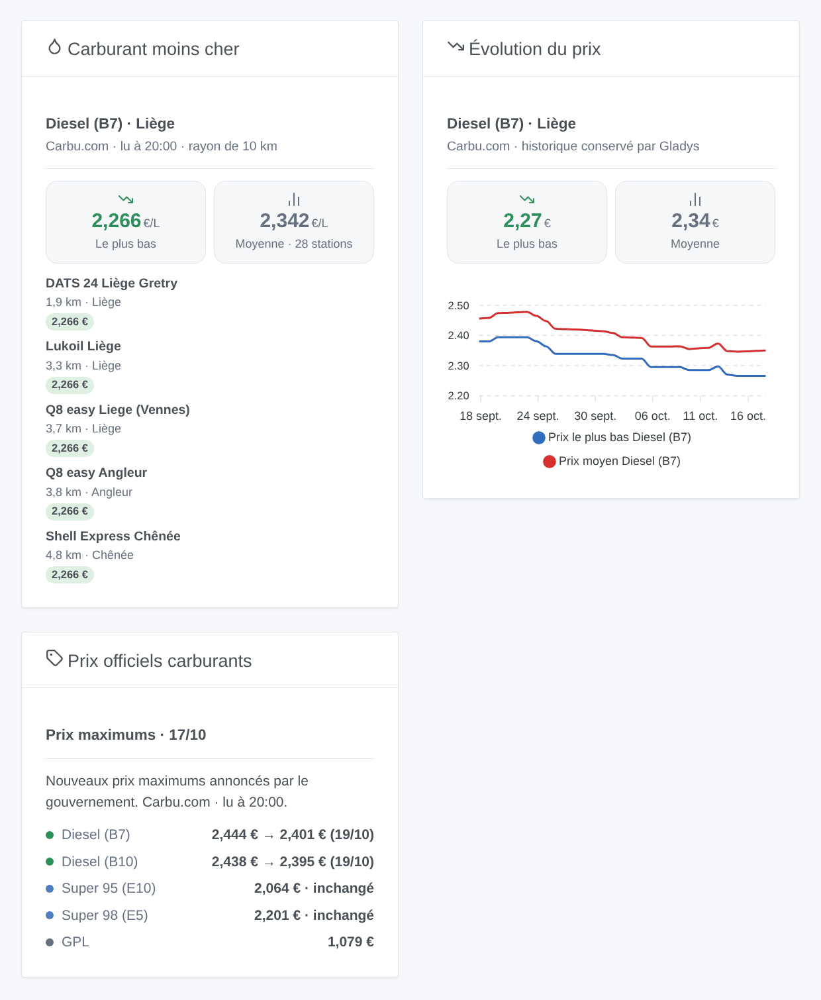

# Gladys Carbu.com

[English](README.md) · **Français** · [Deutsch](README.de.md) · [Español](README.es.md)

[](LICENSE)
[](https://github.com/William-De71/gladys-carbu-com/releases)
[](https://github.com/William-De71/gladys-carbu-com/actions/workflows/release.yml)
[](https://gladysassistant.com)


Intégration externe [Gladys Assistant](https://gladysassistant.com) pour **Carbu.com**, le comparateur de prix des carburants de Belgique, de France et du Luxembourg : le prix le plus bas et le prix moyen autour de chez vous, les stations les moins chères, les prix maximums belges et leur évolution annoncée. Aucun compte : l’intégration lit les pages publiques de Carbu.com pour votre code postal.

Documentation utilisateur : [English](docs/en.md) · [Français](docs/fr.md) · [Deutsch](docs/de.md) · [Español](docs/es.md).

> Intégration communautaire, ni affiliée ni soutenue par Carbu.com ou Fuel Media Service.

## Fonctionnalités

- **Une zone** autour d’une localité (code postal) de Belgique, de France ou du Luxembourg, dans un rayon de 2 à 30 km, pour **quatre carburants** au plus parmi onze (Super 95 E10 et E5, Super 98 E5 et E10, Diesel B7, B10, XTL / HVO, Diesel+, GPL, GNV, E85, selon le pays).
- **Un appareil zone** : prix le plus bas, prix moyen et station la moins chère de chaque carburant, avec l’historique gardé par Gladys.
- **Des appareils station**, proposés parmi les moins chères de chaque carburant : le prix de chaque carburant suivi qu’elles vendent.
- **Un appareil prix officiels** : les prix maximums belges du jour, le suivant (annoncé par le gouvernement, sinon prévu par Carbu.com) et la tendance ; les prix officiels luxembourgeois.
- **5 déclencheurs de scène**, **2 actions de scène** et **3 widgets de tableau de bord** (ci-dessous).
- Les prix trop anciens (des stations françaises affichent des prix de plusieurs années) sont écartés : 7 jours par défaut.
- Lecture toutes les heures par défaut (30 min à 4 h) ; boutons de configuration : tester la connexion, diagnostic.
- Quatre langues partout : anglais, français, allemand, espagnol.

## Fonctionnement




Carbu.com n’a pas d’API : l’intégration lit les mêmes pages qu’un visiteur, en français, en se présentant (`gladys-carbu-com/<version>`). Elle trouve d’abord la localité de votre code postal (une fois, gardée dans `/data`), puis lit à chaque passage **une liste de stations par carburant suivi** (jusqu’à 100 stations autour du centre de la localité, avec la date de chaque prix) et, en Belgique et au Luxembourg, **le tableau des prix officiels**. Elle garde les stations du rayon dont le prix est récent, les classe par prix, publie les états et compare chaque lecture à la précédente pour lancer les déclencheurs de scène.



### Transport

Cloud uniquement (`"transports": ["cloud"]`) : le catalogue affiche le badge cloud. Seuls votre code postal (et la localité choisie) et les codes des carburants suivis partent vers `carbu.com`. Il n’y a pas de voie locale, donc pas de bouton « Préférer la connexion locale ».

## Appareils et fonctionnalités

| Appareil                          | Fonctionnalité                         | Catégorie / type       | Valeurs                                    |
| --------------------------------- | -------------------------------------- | ---------------------- | ------------------------------------------ |
| Carbu.com \<localité\> (\<code\>) | Prix le plus bas, prix moyen \<carb.\> | `currency` / `decimal` | 0 … 10 €/L                                 |
| Carbu.com \<localité\> (\<code\>) | Station la moins chère \<carburant\>   | `text` / `text`        | « Shell Express Liège · 2,274 € · 1,3 km » |
| \<station\>                       | Prix \<carburant\>                     | `currency` / `decimal` | 0 … 10 €/L                                 |
| Carbu.com prix maximums belges    | Prix maximum, prochain prix maximum    | `currency` / `decimal` | 0 … 10 €/L                                 |
| Carbu.com prix maximums belges    | Tendance \<carburant\>                 | `text` / `text`        | « Baisse annoncée le 22/04 : 2,061 € »     |
| Carbu.com prix officiels luxemb.  | Prix officiel \<carburant\>            | `currency` / `decimal` | 0 … 10 €/L                                 |

Les distances sont comptées depuis le centre de la localité, comme sur Carbu.com. Une station ajoutée garde son prix même hors du rayon ; un carburant sans aucun prix récent dans le rayon laisse les prix inchangés et l’indique dans « Station la moins chère ».

## Déclencheurs, actions de scène et widgets



**Déclencheurs de scène** (une fois par transition ; la première lecture sert de référence et ne déclenche rien) :

- **Nouvelle station la moins chère** : une autre station devient la moins chère de la zone pour un carburant (une égalité garde la précédente). Filtre : carburant.
- **Prix modifié dans une station** : le prix d’un carburant change dans une station ajoutée comme appareil. Filtres : station, carburant, sens.
- **Prix officiel modifié** : le prix officiel du jour diffère de celui de la veille (Belgique, Luxembourg). Filtres : carburant, sens.
- **Prix maximum annoncé** : le gouvernement belge annonce un nouveau prix maximum pour le lendemain. Filtres : carburant, sens.
- **Changement de prix maximum prévu** : Carbu.com prévoit une hausse ou une baisse avant l’annonce officielle. Filtres : carburant, sens.

**Actions de scène** : **station la moins chère** d’un carburant (dans une distance donnée : nom, enseigne, adresse, prix, distance, lien vers la carte) et **prix officiels** d’un carburant (aujourd’hui, prix suivant, date, tendance, annoncé ou prévu).

**Widgets** : **Carburant moins cher** (tuiles prix le plus bas et moyen, puis la liste avec distance et lien vers Carbu.com ou la carte), **Évolution du prix** (courbes du prix le plus bas et moyen, tracées par Gladys depuis l’appareil zone) et **Prix officiels carburants**.

Exemples :

- Quand **une hausse du prix maximum du Diesel est annoncée** → m’envoyer « Faites le plein aujourd’hui : {{triggerEvent.data.new_price}} € demain ».
- Quand **la station la moins chère change pour le GPL** → notifier `{{triggerEvent.data.station_name}}` à `{{triggerEvent.data.price}}` €, avec `map_url`.
- Chaque vendredi à 17 h → **lire la station la moins chère** à 5 km et l’annoncer sur l’enceinte de l’entrée.

## Prérequis

- Gladys Assistant **5.3.0** ou plus récent (mots-clés et pays du catalogue de Gladys 5.3, widgets et déclencheurs de scène des intégrations externes). Les instances plus anciennes ne peuvent pas installer l’intégration.
- Un accès à internet. Aucun compte, aucune clé.

## Installation

- **Depuis le store** de Gladys (Intégrations → Intégrations externes), en un clic, une fois indexée.
- **Depuis l’URL du dépôt** : `https://github.com/William-De71/gladys-carbu-com`.
- **Mode développeur** : construisez l’image en local (`docker build -t gladys-carbu-com .`) et installez-la depuis Gladys.

## Configuration

| Champ                                 | Description                                                                                    |
| ------------------------------------- | ---------------------------------------------------------------------------------------------- |
| Pays                                  | Belgique, France ou Luxembourg.                                                                |
| Code postal                           | Le centre de la zone (« 4000 », « 71100 », « 1009 »).                                          |
| Localité (facultatif)                 | Quand le code postal en couvre plusieurs (4000 : Liège, Glain, Rocourt). Vide : la principale. |
| Carburants                            | Quatre au plus ; les pays où Carbu.com référence chaque carburant suivent son nom.             |
| Rayon                                 | 2, 5, 10 (par défaut), 15, 20 ou 30 km.                                                        |
| Ignorer les prix plus anciens que     | 1, 2, 3, 7 (par défaut), 14 ou 30 jours.                                                       |
| Stations proposées dans la découverte | Aucune, 3, 5 (par défaut), 10 ou 20 par carburant.                                             |
| Fréquence de lecture                  | 30 min, 1 h (par défaut), 2 h ou 4 h.                                                          |
| Langue des noms d’appareils           | Automatique (la langue du tableau de bord), ou une langue fixe.                                |

Boutons : **Tester la connexion** (localités du code postal, nombre de stations et prix le plus bas de chaque carburant, prix officiels) et **Diagnostic** (écrit la localité, les lectures et les erreurs dans l’onglet Journaux).

## Utilisation

1. Choisissez le pays, saisissez le code postal et les carburants, puis enregistrez.
2. Dans l’onglet **Découvrir**, créez l’appareil « Carbu.com \<localité\> », l’appareil des prix officiels et les stations qui vous intéressent.
3. Ajoutez les widgets à un tableau de bord, et créez des scènes avec les déclencheurs ci-dessus.

## Développement

```bash
npm install
npm test                       # node --test, ne touche jamais le réseau
npm run lint && npm run format:check
npx github:GladysAssistant/integration-store . --skip-image-check
scripts/build-cover.sh         # cover.jpg depuis docs/assets/cover.svg
docs/illustrations/render.sh   # docs/assets/widgets.<lang>.png
node .github/scripts/release.mjs next
```

En local, le SDK lit `GLADYS_HOST_API_URL`, `GLADYS_INTEGRATION_TOKEN` et `GLADYS_INTEGRATION_SELECTOR` ; `CARBU_BASE_URL` dirige l’intégration vers une autre racine (un bouchon) ; `DEBUG=gladys-integration-sdk` affiche les journaux du SDK et vérifie chaque contenu de widget. Les tests utilisent de vraies pages de Carbu.com, réduites (`test/fixtures/`). Les règles du projet sont dans [CLAUDE.md](CLAUDE.md).

## Processus de release


Chaque fusion sur `main` lance la CI, puis calcule la version depuis les [Conventional Commits](https://www.conventionalcommits.org/) depuis le dernier tag : `feat` → mineure, `fix` / `perf` → correctif, `!` ou `BREAKING CHANGE` → majeure (une mineure avant 1.0.0) ; `docs`, `chore`, `ci`, `test`, `style`, `refactor`, `build` seuls ne publient rien. La section du changelog est générée, le tag poussé, l’image multi-architecture construite, puis `main` reçoit le commit de release, la GitHub Release est créée et un dernier job vérifie l’image publique, le validateur du store et le topic.

- Le titre de la pull request devient le commit squash, puis la ligne du changelog : écrivez-le en anglais, pour l’utilisateur (`pr-title.yml` le vérifie). Ne modifiez jamais `CHANGELOG.md` à la main.
- La 1.0.0 est une décision : Actions → Release → Run workflow avec `release-as: 1.0.0`. `dry-run` affiche la version et les notes sans rien publier.
- **Branche protégée** : la release pousse son commit sur `main` avec `GITHUB_TOKEN`. Avec un ruleset sur `main`, ajoutez GitHub Actions à sa liste de contournement (ou poussez via une GitHub App), sinon le job de publication échoue avec des instructions.
- Après la première release, rendez public le package `ghcr.io` (Package settings → Change visibility), sinon Gladys ne peut pas le télécharger.

## Dépannage

Voir [docs/fr.md](docs/fr.md#dépannage). Signalez les problèmes avec les versions de Gladys et de l’intégration, le pays, le code postal et les carburants, et les lignes du bouton **Diagnostic**.

## Contribuer

Issues et pull requests bienvenues. Lancez `npm run format:check && npm run lint && npm test` avant d’ouvrir une pull request, et gardez inchangés tous les identifiants externes et clés stockées (voir [CLAUDE.md](CLAUDE.md)). Si Carbu.com change sa mise en page, ajoutez la nouvelle page réduite dans `test/fixtures/` avec le correctif.

## Sécurité

Voir [SECURITY.md](SECURITY.md) : signalez les vulnérabilités en privé. L’intégration n’a ni compte ni secret ; elle tourne en lecture seule, sans droits root, dans son conteneur, et ne contacte que `carbu.com`.

## Captures à venir

Les images ci-dessus sont des illustrations, pas des captures d’écran. Les vraies captures iront dans `docs/assets/screenshots/` (PNG, 1280 × 800) : `configuration.png`, `discovery.png`, `device.png`, `scene.png`.

## Licence

[Licence Apache 2.0](LICENSE) — voir aussi [NOTICE](NOTICE). Les prix viennent de [Carbu.com](https://carbu.com) (Fuel Media Service) : les widgets affichent la source et l’heure de chaque lecture. La lecture des pages a été apprise des intégrations Home Assistant carbu_com (myTselection) et carbu-hass (Michel Heusschen). Merci à la documentation et au SDK de Gladys.
