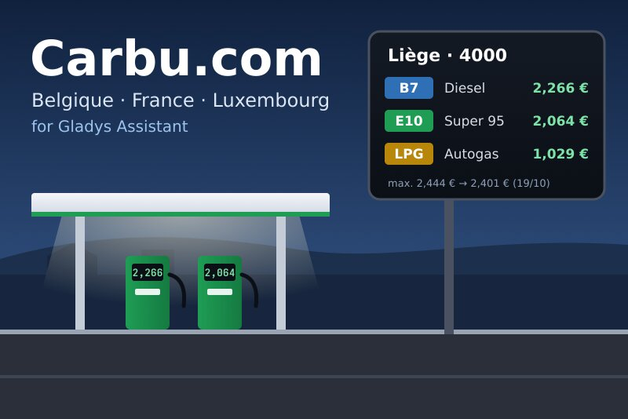
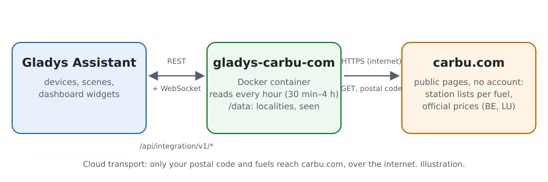
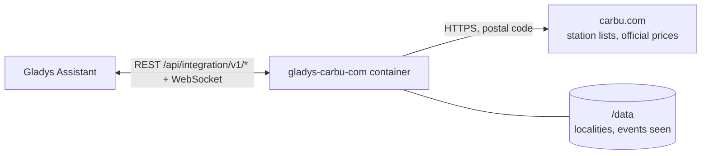
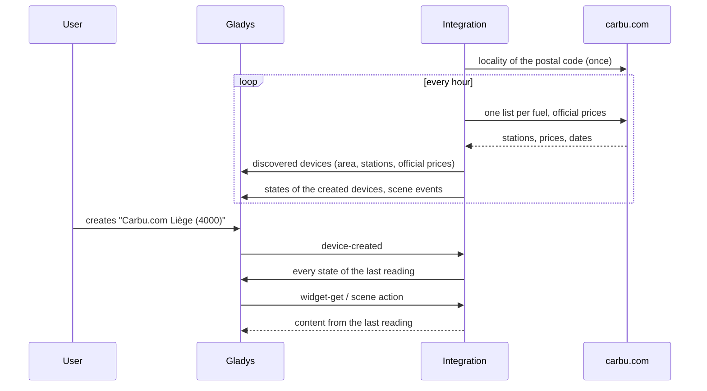
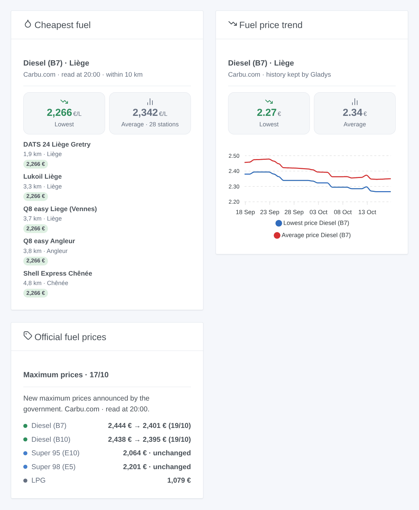

# Gladys Carbu.com

**English** · [Français](README.fr.md) · [Deutsch](README.de.md) · [Español](README.es.md)

[](LICENSE)
[](https://github.com/William-De71/gladys-carbu-com/releases)
[](https://github.com/William-De71/gladys-carbu-com/actions/workflows/release.yml)
[](https://gladysassistant.com)



A [Gladys Assistant](https://gladysassistant.com) external integration for **Carbu.com**, the fuel price comparator of Belgium, France and Luxembourg: the lowest and average prices around your home, the cheapest stations, and the Belgian maximum prices with what comes next. No account: the integration reads the public pages of Carbu.com for your postal code.

User documentation: [English](docs/en.md) · [Français](docs/fr.md) · [Deutsch](docs/de.md) · [Español](docs/es.md).

> Community integration, not affiliated with or endorsed by Carbu.com or Fuel Media Service.

## Features

- **An area** around a locality (postal code) of Belgium, France or Luxembourg, within 2 to 30 km, for up to **four fuels** among eleven (Super 95 E10 and E5, Super 98 E5 and E10, Diesel B7, B10, XTL / HVO, premium diesel, LPG, CNG, E85, depending on the country).
- **An area device**: the lowest price, the average price and the cheapest station of each fuel, with the history Gladys keeps.
- **Station devices**, offered among the cheapest of each fuel: the price of each followed fuel they sell.
- **An official price device**: today's Belgian maximum prices, the next one (announced by the government, else expected by Carbu.com) and the outlook; the Luxembourg official prices.
- **5 scene triggers**, **2 scene actions** and **3 dashboard widgets** (below).
- Outdated prices (some French stations show prices years old) are set aside: 7 days by default.
- Read every hour by default (30 min to 4 h); configuration buttons: test the connection, diagnostic.
- Four languages everywhere: English, French, German, Spanish.

## How it works





Carbu.com has no API: the integration reads the pages a visitor reads, in French, introducing itself (`gladys-carbu-com/<version>`). It first finds the locality of your postal code (once, kept in `/data`), then reads at each round **one station list per followed fuel** (up to 100 stations around the centre of the locality, with the date of each price) and, in Belgium and Luxembourg, **the official price table**. It keeps the stations within the radius whose price is recent, ranks them by price, publishes the states and compares each reading with the previous one to fire the scene triggers.



### Transport

Cloud only (`"transports": ["cloud"]`): the catalog shows the cloud badge. Only your postal code (and the locality chosen) and the codes of the followed fuels go to `carbu.com`. There is no local path, hence no "Prefer the local connection" button.

## Devices and features

| Device                               | Feature                              | Category / type        | Values                                   |
| ------------------------------------ | ------------------------------------ | ---------------------- | ---------------------------------------- |
| Carbu.com \<locality\> (\<code\>)    | Lowest price, average price \<fuel\> | `currency` / `decimal` | 0 … 10 €/L                               |
| Carbu.com \<locality\> (\<code\>)    | Cheapest station \<fuel\>            | `text` / `text`        | "Shell Express Liège · 2,274 € · 1,3 km" |
| \<station\>                          | Price \<fuel\>                       | `currency` / `decimal` | 0 … 10 €/L                               |
| Carbu.com Belgian maximum prices     | Maximum price, next maximum price    | `currency` / `decimal` | 0 … 10 €/L                               |
| Carbu.com Belgian maximum prices     | Outlook \<fuel\>                     | `text` / `text`        | "Decrease announced on 22/04: 2,061 €"   |
| Carbu.com Luxembourg official prices | Official price \<fuel\>              | `currency` / `decimal` | 0 … 10 €/L                               |

Distances are counted from the centre of the locality, as on Carbu.com. An added station keeps its price even outside the radius; a fuel without any recent price within the radius leaves the prices unchanged and says so in "Cheapest station".

## Scene triggers, actions and widgets



**Scene triggers** (once per transition; the first reading is a baseline and fires nothing):

- **New cheapest station**: another station becomes the cheapest of the area for a fuel (a draw keeps the previous one). Filter: fuel.
- **Price changed at a station**: the price of a fuel changes at a station added as a device. Filters: station, fuel, direction.
- **Official price changed**: today's official price differs from yesterday's (Belgium, Luxembourg). Filters: fuel, direction.
- **Maximum price announced**: the Belgian government announces a new maximum price for the next day. Filters: fuel, direction.
- **Maximum price change expected**: Carbu.com expects a rise or a fall before the official announcement. Filters: fuel, direction.

**Scene actions**: **cheapest station** of a fuel (within a distance: name, brand, address, price, distance, map link) and **official prices** of a fuel (today, next price, date, trend, announced or expected).

**Widgets**: **Cheapest fuel** (lowest and average price tiles, then the list with the distance and a link to Carbu.com or the map), **Fuel price trend** (lowest and average price curves, drawn by Gladys from the area device) and **Official fuel prices**.

Examples:

- When **a rise of the Diesel maximum price is announced** → send me "Fill up today: {{triggerEvent.data.new_price}} € tomorrow".
- When **the cheapest LPG station changes** → notify `{{triggerEvent.data.station_name}}` at `{{triggerEvent.data.price}}` €, with `map_url`.
- Every Friday at 5 pm → **read the cheapest station** within 5 km and announce it on the hall speaker.

## Requirements

- Gladys Assistant **5.1.1** or later (widgets and scene triggers of external integrations). Older instances cannot install the integration.
- Internet access. No account, no key.

## Installation

- **From the Gladys store** (Integrations → External integrations), in one click, once indexed.
- **From the repository URL**: `https://github.com/William-De71/gladys-carbu-com`.
- **Developer mode**: build the image locally (`docker build -t gladys-carbu-com .`) and install it from Gladys.

## Configuration

| Field                         | Description                                                                             |
| ----------------------------- | --------------------------------------------------------------------------------------- |
| Country                       | Belgium, France or Luxembourg.                                                          |
| Postal code                   | The centre of the area ("4000", "71100", "1009").                                       |
| Locality (optional)           | When the postal code covers several (4000: Liège, Glain, Rocourt). Empty: the main one. |
| Fuels                         | Four at most; the countries where Carbu.com lists each fuel follow its name.            |
| Radius                        | 2, 5, 10 (default), 15, 20 or 30 km.                                                    |
| Ignore prices older than      | 1, 2, 3, 7 (default), 14 or 30 days.                                                    |
| Stations offered in Discovery | None, 3, 5 (default), 10 or 20 per fuel.                                                |
| Reading interval              | 30 min, 1 h (default), 2 h or 4 h.                                                      |
| Language of device names      | Automatic (the language of the dashboard), or a fixed language.                         |

Buttons: **Test the connection** (localities of the postal code, number of stations and lowest price of each fuel, official prices) and **Diagnostic** (writes the locality, the readings and the errors to the Logs tab).

## Usage

1. Choose the country, type the postal code and the fuels, then save.
2. In the **Discover** tab, create the "Carbu.com \<locality\>" device, the official price device and the stations you care about.
3. Add the widgets to a dashboard, and create scenes with the triggers above.

## Development

```bash
npm install
npm test                       # node --test, never touches the network
npm run lint && npm run format:check
npx github:GladysAssistant/integration-store . --skip-image-check
scripts/build-cover.sh         # cover.jpg from docs/assets/cover.svg
docs/illustrations/render.sh   # docs/assets/widgets.<lang>.png
node .github/scripts/release.mjs next
```

Locally, the SDK reads `GLADYS_HOST_API_URL`, `GLADYS_INTEGRATION_TOKEN` and `GLADYS_INTEGRATION_SELECTOR`; `CARBU_BASE_URL` points the integration to another root (a stub); `DEBUG=gladys-integration-sdk` prints the SDK logs and checks every widget content. The tests use real pages of Carbu.com, reduced (`test/fixtures/`). The rules of the project are in [CLAUDE.md](CLAUDE.md).

## Release process


Every merge on `main` runs the CI, then computes the version from the [Conventional Commits](https://www.conventionalcommits.org/) since the last tag: `feat` → minor, `fix` / `perf` → patch, `!` or `BREAKING CHANGE` → major (a minor before 1.0.0); `docs`, `chore`, `ci`, `test`, `style`, `refactor`, `build` alone publish nothing. The changelog section is generated, the tag pushed, the multi-arch image built, then `main` receives the release commit, the GitHub Release is created and a last job checks the public image, the store validator and the topic.

- The pull request title becomes the squash commit, then the changelog line: write it in English, for the user (`pr-title.yml` checks it). Never edit `CHANGELOG.md` by hand.
- 1.0.0 is a decision: Actions → Release → Run workflow with `release-as: 1.0.0`. `dry-run` shows the version and the notes without publishing anything.
- **Protected branch**: the release pushes its commit to `main` with `GITHUB_TOKEN`. With a ruleset on `main`, add GitHub Actions to its bypass list (or push through a GitHub App), otherwise the publish job fails with instructions.
- After the first release, make the `ghcr.io` package public (Package settings → Change visibility), otherwise Gladys cannot download it.

## Troubleshooting

See [docs/en.md](docs/en.md#troubleshooting). Report problems with the Gladys and integration versions, the country, postal code and fuels, and the lines of the **Diagnostic** button.

## Contributing

Issues and pull requests are welcome. Run `npm run format:check && npm run lint && npm test` before opening a pull request, and keep every external id and stored key unchanged (see [CLAUDE.md](CLAUDE.md)). If Carbu.com changes its layout, add the new reduced page to `test/fixtures/` with the fix.

## Security

See [SECURITY.md](SECURITY.md): report vulnerabilities privately. The integration has no account and no secret; it runs read-only, without root rights, in its container, and only contacts `carbu.com`.

## Screenshots to come

The images above are illustrations, not screenshots. Real screenshots will go to `docs/assets/screenshots/` (PNG, 1280 × 800): `configuration.png`, `discovery.png`, `device.png`, `scene.png`.

## License

[Apache License 2.0](LICENSE) — see also [NOTICE](NOTICE). The prices come from [Carbu.com](https://carbu.com) (Fuel Media Service): the widgets show the source and the time of each reading. Reading the pages was learnt from the Home Assistant integrations carbu_com (myTselection) and carbu-hass (Michel Heusschen). Thanks to the documentation and the SDK of Gladys.
